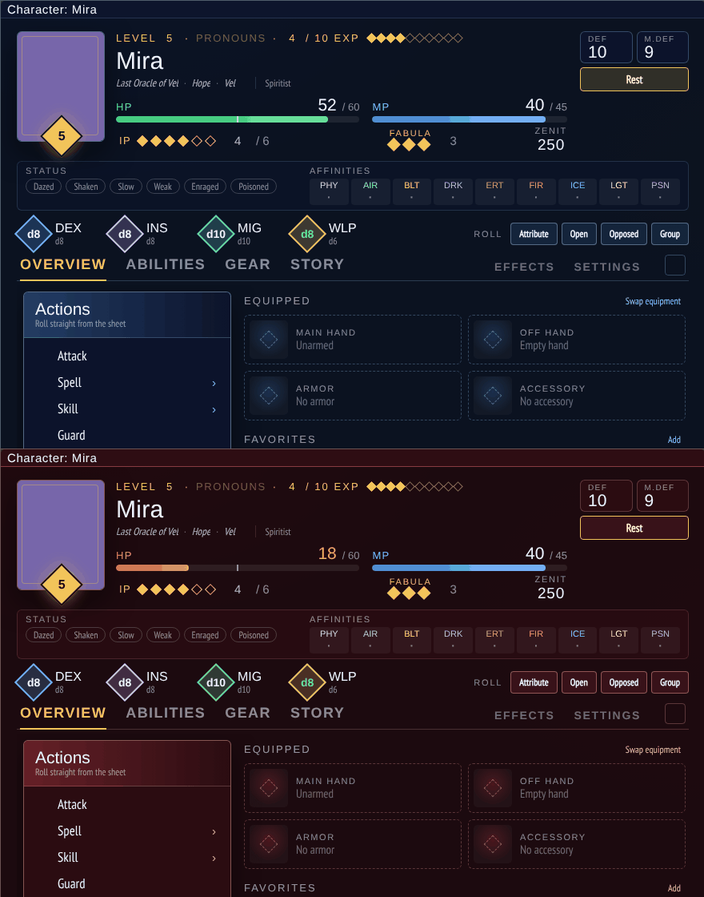
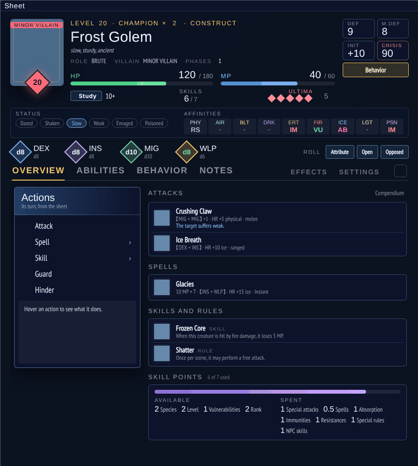
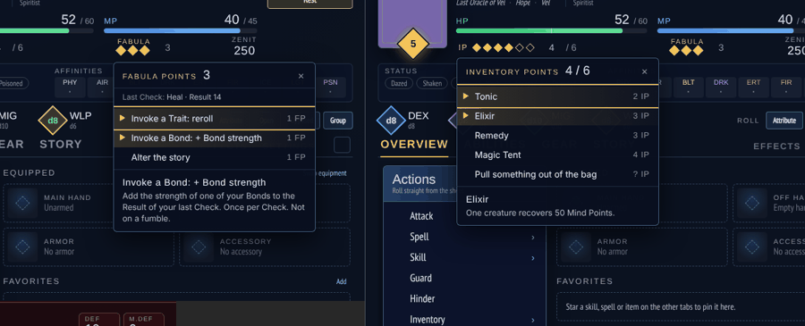
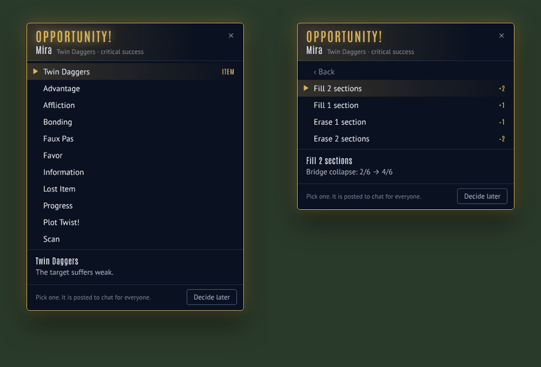
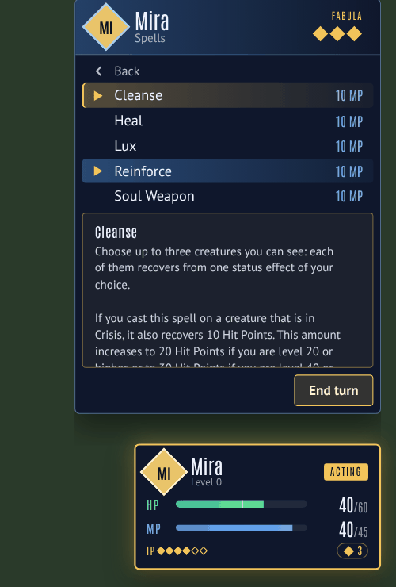
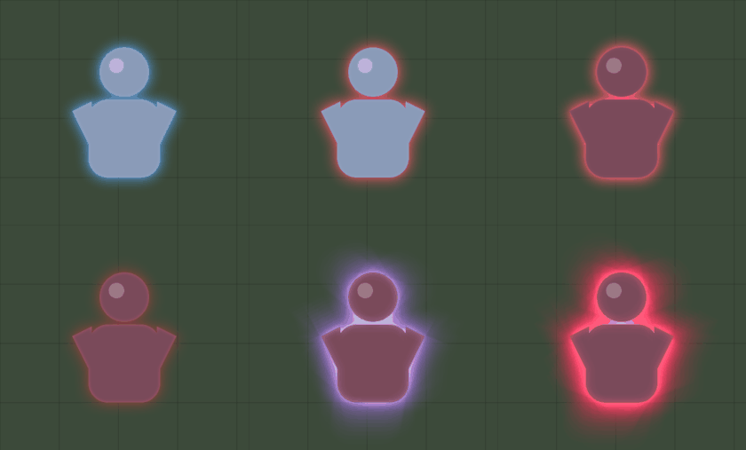

# Fabula Ultima Battle UI

JRPG-style battle screen for the Project FU system (Foundry v13, Project FU 4.14+).

Highlights: turn track and command menus, scene clocks, Study-gated enemy info, Fabula / Inventory / Ultima point menus, an Opportunity menu on every critical, a customizable glow on the active token (stronger for bosses, different in Crisis), Battle UI character, NPC and party sheets that turn red in Crisis, lockable full-length skill and spell descriptions, and FFXIII / FFVII menu sounds with a per-cue sound editor.

## Screenshots
| | |
|---|---|
|  |  |
| Character sheet, normal and in Crisis | NPC sheet |
|  |  |
| Fabula and Inventory Point menus | Opportunity menu on a critical |
|  |  |
| Battle menu with a locked spell description | Turn glow: hero, hero in Crisis, enemy / enemy in Crisis, boss, boss in Crisis |

## Install
In Foundry: Add-on Modules → Install Module → paste this Manifest URL:
`https://github.com/EclipseGS27/fu-battle-ui/releases/latest/download/module.json`
Requires Foundry v13 and the Project FU system.

## Open it
- Opens automatically when a conflict starts.
- Shift+B, the gamepad button in the Token controls, or the "Battle UI" button in the combat tracker.

## What it does
- **Turn track**: past turns, who is acting now, and a forecast that alternates sides (the larger side finishes the round). Uses Project FU's own turn system, so the combat tracker stays in sync.
- **Heroes' turn**: players pick which hero acts (party cards or the right panel), then use the command menu: Attack, Spell, Skill, Guard, Hinder, Inventory, Study, Objective, Equipment. Everything rolls through Project FU. End turn is at the bottom of the menu.
- **Foes' turn (GM)**: pick which enemy acts (warns if an Elite/Champion would act twice in a row), roll its attacks, spells, skills and special rules (grouped like on its sheet), telegraph a charged attack, end its turn.
- **Target panel**: enemy info gated by Study. Reads the party's Study results from the active Party; the GM can also set what players know (Basic / Full / All) and click single Affinities to reveal them. Affinities are revealed automatically when hit (setting). With a detailed Study (or All), it also lists the enemy's attacks, spells, skills and special rules: hover one to read it, click to pin it.
- **Scene clocks**: stored on the scene, so they persist between conflicts. Threat / goal / scene kinds, "+1 each round", hidden from players. GM: + and − on each card, click a name to edit, clock button in the top bar to add. Players fill clocks through Objective; the GM approves (or set "Players change clocks directly").
- **Banners, floating damage numbers**, Villain Ultima Points, Zero Power clocks on party cards, Crisis, statuses. Numbers on the same target stack instead of overlapping. With Fabula Ultima Battle Animations installed, its damage numbers (and MISS) take over, so you never get two sets.
- **Targets reset each turn**: everyone's targets are cleared when a turn starts or ends (client setting).
- **Conditions explained**: hover any status chip (battle screen, sheets, party cards) for what it does and how long it lasts, in Project FU's own words. Hover a token on the map for a card listing its conditions.
- **Fabula Points**: click FABULA in the command menu or the ◆ chip on a party card. Invoke a Trait (reroll) or a Bond (+ Bond strength) on your last Check through Project FU's own reroll/push, or spend 1 FP to alter the story. Works any time, not only on your turn.
- **Ultima Points (GM)**: click ULTIMA on a Villain's turn panel or the Ultima pips in the target panel. Invoke a Trait (reroll), Recovery (clear statuses, +50 MP) or Escape.
- **Inventory Points**: the Inventory menu lists the sheet's consumables plus the Core items (Elemental Shard, Tonic, Elixir, Remedy, Magic Tent) from Project FU's compendium; a Core item is added to the sheet the first time it's used, then rolled so IP is spent and the effect applied by the system. "Pull something out of the bag" spends a GM-set amount of IP for an uncommon item.
- **Opportunities**: when a Check crits (attacks, spells, skills or plain checks), a menu opens with the choices: the item's own Opportunity first, then the world's opportunity table (Project FU's homebrew setting) or the Core Rulebook list. Progress lets you pick a clock and fill or erase up to two sections. The pick is posted to chat with a banner. "Decide later" closes it; the chat card's Apply opportunity button opens the same menu.
- **Descriptions**: the box under each menu shows an entry's full rules text, with Project FU's inline tags written out ("HR + 10 fire damage", "suffers dazed") instead of dropped. Right-click an entry (or click the pin) to lock its description so you can move the mouse onto it and scroll; right-click again or click the pin to unlock.
- **Turn glow**: the token whose turn it is glows instead of showing Foundry's turn marker. Heroes, enemies and bosses (Villains and/or Champions) each have a style (Soft, Pulse, Energy aura, Flicker), color, strength, size and speed, plus a separate look for when they are in Crisis. Configure it under Settings → Turn glow, with a Preview on the selected token.
- **Surrender or Sacrifice** prompt when a PC hits 0 HP. Surrender gives 2 Fabula Points and marks them defeated.

## Battle UI character sheet
A Player Character sheet in the battle screen's look. It is built on Project FU's own sheet, so every roll, equip, favorite, drag-and-drop and compendium button works the same; the system's skill, spell, item and effect tables are embedded and re-colored.
- Turn it on per character: open the sheet, click **Sheet** in the window header, pick **Battle UI Sheet**. Or set it as the default for new characters in the module settings.
- **Header**: portrait (click to change), level, pronouns, EXP with a Level up button at 10, name with Identity · Theme · Origin under it, HP with the Crisis mark (the whole sheet turns red in Crisis), MP, IP (click for the Inventory menu), Fabula Points (click for the Fabula menu: Trait, Bond, alter the story), Zenit, DEF / M.DEF (INIT and Crisis optional), Rest (right-click to rest without restoring IP), status toggles, Affinities (click to post one to chat), attribute dice (click to roll a check, pick the base die underneath), and the Roll box: Attribute / Open / Opposed / Group checks.
- **Collapse**: the chevron at the right end of the tab bar shrinks the header to one line (name, level, HP, MP, IP, active statuses) so the tabs get the room. Remembered per browser.
- **Overview**: the battle command menu (hover for what each does), equipped gear with icons (click a weapon to attack, click an icon to change it), favorites.
- **Abilities**: class cards with class level and skill levels (pen to open, bin to remove the class), then skills, Heroic Skills, spells, rituals and features.
- **Gear**: equipped slots, how DEF, M.DEF and INIT add up, Inventory Points, Zenit with party deposit/withdraw, and every item table.
- **Story**: Bonds (click a feeling to set or clear it; strength updates on its own), notes.
- **Effects** and **Settings**: Project FU's own tabs, repainted to match.

## Level up
At 10 EXP a pulsing **LEVEL UP** button appears on the portrait (and in the collapsed header, the Abilities tab, and the character's card on the Battle UI party sheet); the EXP diamonds next to the level fill as EXP comes in. The button opens one dialog: spend 10 EXP, gain a level, pick the class that gets the class level (its new class level and whether it masters is shown) or a new class, and at levels 20, 40 and 60 the attribute to raise. Then it plays a fanfare and a LEVEL UP! flourish, can announce it in chat, and opens the compendium on that class's Skills (or on classes, for a new one).

## Battle UI NPC sheet
The same look, built for adversaries. Pick **Battle UI NPC Sheet** from an NPC's Sheet button, or make it the default in the module settings.
- **Header**: level (steps of 5), rank (with how many soldiers a Champion replaces), species, traits, role, villain type and phases, HP with the Crisis mark, MP, Study result with a Study button, skill points used / available, Ultima Points for villains (click for the Ultima menu: Trait, Recovery, Escape), DEF / M.DEF (INIT and Crisis optional), a Behavior roll button (or an Open check when behavior rolls are off), status toggles, Affinities, attribute dice and the Roll box. Villains get a red level diamond and a tag on the portrait. Collapses like the character sheet.
- **Overview**: the NPC's command menu, its attacks and spells with their full lines (【MIG + MIG】 +1 · HR +5 physical), skills and special rules (click to use, pen to edit, bin to remove), and a skill point budget broken down into what it has and what it spent.
- **Abilities**: Project FU's tables for basic attacks, skills, spells, abilities, rules and loot. **Gear** appears when the NPC uses equipment, **Behavior** when behavior rolls are on. **Notes**, **Effects** and **Settings** as usual.

## Battle UI party sheet
Pick **Battle UI Party Sheet** from a party's Sheet button, or make it the default in the module settings. Laid out like a JRPG main menu:
- **Menu (left)**: Party, Inventory, Adversaries, Codex, Bonds, Settings, with a glowing cursor on the open one; then Rest / Award / Add clock for the GM, the Fabula & Ultima tracker and Refresh; the party's clocks; and the party's Zenit, EXP earned, and Fabula and Ultima spent.
- **Party (right)**: a tall arched card per character, side by side: portrait, Lv. and name, EXP toward the next level, HP (with Crisis), MP, IP, DEF / M.DEF / INIT, main class and level, identity, other classes, Fabula Points, and their token art in a framed diamond at the foot (animated tokens play). Crisis cards glow orange, knocked-out ones go grey, LEVEL UP shows at 10 EXP, active statuses sit on the portrait. Click a portrait to open that sheet, the diamond for their Status page; GMs right-click to remove. Companions follow as slimmer cards; more than fit scroll sideways.
- **Status page** (the diamond at the foot of a card): portrait with level and token, name, Identity / Theme / Origin, EXP, HP / MP with Crisis, IP, Fabula, Zenit, DEF / M.DEF / INIT with how they add up, attribute dice, Affinities, conditions, equipment, classes with their skill levels, and Bonds. ◀ ▶ steps through the party; Open sheet and Level up are on top.
- **Adversaries**: every enemy the party has met, with search and rank/species filters, and for the one you pick, what the party has learned by Study: level, rank, Species, HP and MP (basic), then Traits, Attributes, defenses and every Affinity (complete), then its attacks, spells, skills and special rules with their full text (detailed). Affinities revealed by hits show even before that. The GM sees everything, with a note on what players know. Project FU's own profile is a click away.
- **Inventory, Codex, Bonds, Settings**: Project FU's own tabs, re-themed, open on the right.

## Other
- **Compendium browser**: Project FU's compendium browser in the same look: the sheet's tab bar, a search box, filters as toggle chips, re-themed tables, and menu sounds. Drag a whole row onto a sheet (not just its icon), or click the + on a row to add it to the character sheet you have open. Turn it off with "Battle UI compendium browser".
- **Check dialog**: Project FU's check prompt (Attribute, Open, Opposed, Group, Ritual) gets the same look: attribute diamonds with their current dice for Primary and Secondary, the roll formula and DL up top, a − / + modifier, and Easy 7 / Normal 10 / Hard 13 / Very hard 16 buttons. It's still the system's dialog underneath, so remembered choices and bonuses work as before. Turn it off with "Battle UI check dialog".
- **Sounds**: cursor and confirm sounds from the chosen pack. Turn them off for the sheet alone with "Sounds on the character sheet".

## Sound effects
Cues play on Foundry's Interface volume channel, each client for itself. Action banners are silent. Pick the pack per player in settings (Sound effects): FFXIII (default), FFVII, a custom folder, or Off. The same pack plays on the Battle UI character, NPC and party sheets: cursor on hover, confirm on choosing, back on closing or removing, a chime for party rests and awards, a fanfare on level up.

| Cue | When | FFXIII file | FFVII file |
|---|---|---|---|
| cursor | moving across menu rows, picks, roster | deck_ui_navigation | deck_ui_navigation |
| confirm | choosing a command, item, hero, target | deck_ui_side_menu_fly_out | confirmation_positive |
| back | Back, close, deny | deck_ui_side_menu_fly_in | confirmation_negative |
| activate | End turn | deck_ui_tab_transition_01 | deck_ui_default_activation |
| turn | your side's turn starts | deck_ui_show_modal | deck_ui_switch_toggle_on |
| chime | clock banners, Fabula/Ultima spent | deck_ui_tab_transition_01 | deck_ui_toast |
| fanfare | conflict start, new round | deck_ui_achievement_toast | deck_ui_launch_game |
| error | not enough IP/FP, unavailable invoke, charged-attack warning | deck_ui_hide_modal | bumper_end |

Settings → Customize sounds lets each player pick what every cue plays: any FFXIII or FFVII sound, their own file, or silence. Default follows the chosen pack.

Files live in sounds/ff13 and sounds/ff7, named after the cue. A custom folder needs the same 8 .ogg names.
The bundled sounds come from the free "FFVII Menu Sounds" and "Final Fantasy XIII Menu Sounds" packs.

## Settings
World: turn glow (style per side and in Crisis), Battle UI sheet as default (characters, NPCs and parties separately), custom sound folder, replace system HUD, hide unstudied stats, auto-reveal Affinities, players change clocks directly, tick round clocks, surrender prompt.
Client: opportunity menu (open on crit / from the chat button only / off), condition cards on tokens, clear targets when the turn changes, INIT and Crisis tiles on the sheet (off by default), sheet turns red in Crisis (on by default), sound effects (FFXIII / FFVII / custom / Off), SFX volume, menu sounds on/off, sounds on the character sheet on/off, auto-open, UI size (multiplier on top of auto-fit; also the A− / A+ buttons in the top bar), banners, floating numbers.

GM tip: the eye button in the top bar previews the player view.

Fonts: Antonio and PT Sans, SIL Open Font License (see fonts/).
